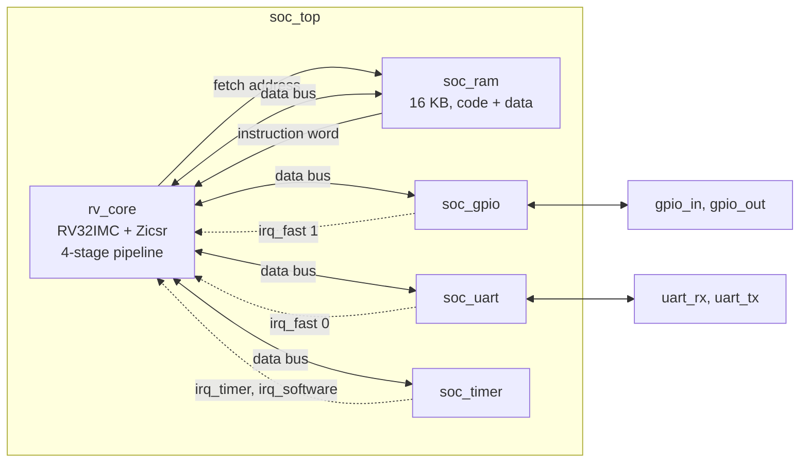
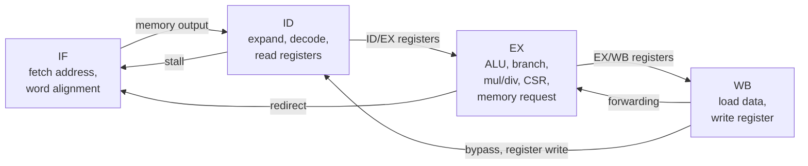
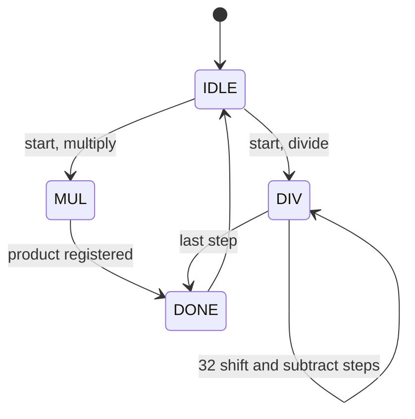
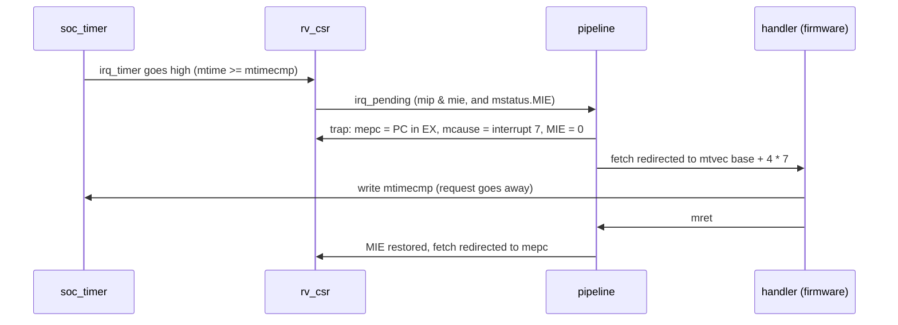

# RISC-V SoC example (RV32IMC)

A small but complete RISC-V system-on-chip written in plain Verilog-2005, sized to run
comfortably in VeriSim: a 4-stage pipelined **RV32IMC + Zicsr** core, block RAM, GPIO, UART
and timer, running firmware written in C with three interrupt sources.

The instruction set matches the core of the ESP32-C3 (RV32IMC). The peripherals and memory
map are this project's own and are not ESP32-C3 compatible.

New to pipelined processors? The second half of this page, [How it works](#how-it-works),
is a guided tour of the design with block diagrams and cycle-by-cycle examples.

## Run it in VeriSim

**[Open in VeriSim](https://senolgulgonul.github.io/verisim/?design=examples/riscv-soc/design.v&testbench=examples/riscv-soc/testbench.v)**
and press **Run**. The link loads `design.v` and `testbench.v` from this folder.

Expected console output:

```
RV32IMC SoC   misa=0x40001104
primes: 2 3 5 7 11 13 17 19 23 29 31 37 41 43 47
ticks=3 rx=ABC buttons=1 leds=3
mcycle=15397 minstret=7427
ALL OK
---------------------------------
18641 cycles, 8275 instructions (CPI 2.25), 7 traps, 153 characters
RESULT: PASS
```

The text above the dashed line is not printed by the testbench directly. It is what the
firmware sends over the simulated UART; the testbench decodes the `uart_tx` line bit by bit
and prints each character.

With a local Icarus Verilog:

```
iverilog -g2005 -o sim design.v testbench.v && vvp sim
```

## What the demo does

The firmware (`firmware/main.c`):

1. prints a banner and the `misa` CSR,
2. enables three interrupts: the timer, UART receive and GPIO pin 0,
3. finds the primes below 50 (using `REMU`) and prints them in decimal (`DIVU`/`REMU`),
4. waits until it has seen 3 timer ticks, 3 received characters and 1 button press,
5. checks its own results, prints `ALL OK` and sends EOT (0x04).

Meanwhile the testbench sends `abc` to the UART receiver and presses the "button"
(`gpio_in[0]`) once. The interrupt handlers upper-case the received characters, count the
button press, and show the tick count on the GPIO outputs.

The testbench stops at EOT and reports `RESULT: PASS` if the last line was `ALL OK`.

## Files

```
examples/riscv-soc/
├── design.v          core + SoC, one self-contained file
├── testbench.v       testbench with the firmware image embedded
├── README.md
├── firmware/         C sources of the demo firmware
│   ├── main.c        the demo program and interrupt handlers
│   ├── crt0.S        reset code and vectored trap table
│   ├── soc.h         peripheral register map, CSR helpers
│   ├── link.ld       linker script (16 KB RAM at address 0)
│   ├── embed.py      writes firmware.bin into ../testbench.v
│   └── Makefile
├── regress/          verification of the core
│   ├── run.sh        runs the official riscv-tests
│   ├── tb_regress.v  testbench used by run.sh
│   ├── tb_muldiv.v   unit test of the multiply/divide unit
│   └── env_irq/      test environment that injects random interrupts
└── tang-nano-9k/     FPGA build for the Sipeed Tang Nano 9K (see its README)
```

`design.v` and `testbench.v` are all VeriSim needs. The other folders are for changing the
firmware, re-running the verification on a PC, and building the design for an FPGA board.

## Architecture

### Core (`rv_core`)

| Item | Implementation |
| --- | --- |
| ISA | RV32I, M (multiply/divide), C (compressed), Zicsr; machine mode only |
| Pipeline | 4 stages: IF, ID, EX, WB |
| Memories | synchronous read, 32-bit words (block RAM friendly) |
| Data hazards | EX←WB forwarding, ID←WB bypass, 1-cycle stall on load-use |
| Control hazards | branches and jumps resolve in EX, 1-cycle penalty when taken |
| Multiply | 33×33 signed multiplier, 3 cycles |
| Divide | restoring radix-2, 34 cycles |
| Compressed | 16-bit instructions are expanded to 32-bit in ID; 32-bit instructions may straddle two words |
| Traps | taken in EX, which is the commit point; precise |

Modules in `design.v`:

| Module | Purpose |
| --- | --- |
| `rv_alu`, `rv_regfile`, `rv_immgen`, `rv_decoder` | base RV32I datapath |
| `rv_cdecoder` | expands compressed instructions |
| `rv_muldiv` | multi-cycle multiply / divide |
| `rv_csr` | CSRs, cycle and instruction counters, interrupt selection |
| `rv_core` | pipeline top level |
| `soc_ram` | byte-writable block RAM with two read ports (code and data) |
| `soc_gpio`, `soc_uart`, `soc_timer` | peripherals |
| `soc_top` | core + memory + peripherals |

### Traps

| Kind | `mcause` |
| --- | --- |
| Illegal instruction (also: access to a non-existent CSR) | 2 |
| `EBREAK` | 3 |
| Misaligned load | 4 |
| Misaligned store | 6 |
| `ECALL` | 11 |
| Software interrupt (`MSIP`) | interrupt 3 |
| Timer interrupt (`mtime >= mtimecmp`) | interrupt 7 |
| External interrupt (unused in this SoC) | interrupt 11 |
| Fast interrupt 0: UART receive | interrupt 16 |
| Fast interrupt 1: GPIO | interrupt 17 |

`mtvec` supports direct and vectored mode; the firmware uses vectored mode. Interrupt
priority is fast 31..16 (highest number first), then external, software, timer.

### Memory map

| Address | Register | Access | Description |
| --- | --- | --- | --- |
| `0x0000_0000` | RAM | rw | code + data, 16 KB by default (`RAM_AW`) |
| `0x4000_0000` | `GPIO_OUT` | rw | 8 output pins |
| `0x4000_0004` | `GPIO_IN` | ro | 8 input pins (synchronised) |
| `0x4000_0008` | `GPIO_IRQ_EN` | rw | rising-edge interrupt enable per input pin |
| `0x4000_000C` | `GPIO_IRQ_PEND` | rw | pending edges, write 1 to clear |
| `0x4000_1000` | `UART_DATA` | rw | write: transmit a byte; read: received byte (clears `RX_VALID`) |
| `0x4000_1004` | `UART_STATUS` | ro | bit 0 `TX_BUSY`, bit 1 `RX_VALID` |
| `0x4000_1008` | `UART_DIV` | rw | clock cycles per bit |
| `0x4000_100C` | `UART_CTRL` | rw | bit 0: receive interrupt enable |
| `0x4000_2000` | `MTIME` (low, high at `+4`) | rw | 64-bit cycle counter |
| `0x4000_2008` | `MTIMECMP` (low, high at `+4`) | rw | timer compare value |
| `0x4000_2010` | `MSIP` | rw | bit 0: software interrupt |

### Bus

The peripherals sit directly on the core's data bus: address, write data and byte strobes
in one cycle, read data in the next, exactly like a synchronous RAM. There are no wait
states, so a peripheral only has to register its read data.

## Looking at waveforms

To keep the VCD small (about 1.3 MB), the testbench dumps only its own top-level signals:
`pc`, `trap_taken`, `mcause`, the three interrupt requests, the data bus
(`bus_addr`, `bus_wstrb`, `bus_wdata`), `uart_tx`, `uart_rx`, `gpio_in` and `gpio_out`.

Things worth looking at:

- `uart_tx`: start bit, 8 data bits LSB first, stop bit; 8 clock cycles per bit.
- `irq_timer` rising, then `trap_taken` with `mcause = 0x80000007`, then `gpio_out` counting.
- `uart_rx` activity followed by `irq_uart` and a trap with `mcause = 0x80000010`.

To see inside the core, change `$dumpvars(1, testbench)` to `$dumpvars(0, testbench)`.
The VCD then grows to tens of megabytes, which is slow in a browser; shorten the run first.

## Changing the firmware

Requires a RISC-V GCC (`riscv64-unknown-elf-gcc` with rv32imc multilib; on Debian/Ubuntu:
`apt install gcc-riscv64-unknown-elf`) and Python 3.

```
cd firmware
make
```

This builds `firmware.bin` and rewrites the firmware block in `../testbench.v` (between the
`FIRMWARE-BEGIN` and `FIRMWARE-END` markers), so the testbench stays a single file that can
be pasted into VeriSim.

Notes for firmware authors:

- The UART runs at 8 clock cycles per bit in the testbench (`UART_DIV`) to keep the
  simulation short.
- Interrupt handlers are plain C functions marked `__attribute__((interrupt("machine")))`.
- There is no C library; `main.c` brings its own print routines.
- Initialised data lives in the same RAM image as the code, so no copy loop is needed.

## Verification

The core is tested with the official [riscv-tests](https://github.com/riscv-software-src/riscv-tests)
using their unmodified "p" environment.

| Run | Result |
| --- | --- |
| `rv32ui`, `rv32um` built as rv32im and again as rv32imc; `rv32uc`; `rv32mi` | 111 of 111 pass |
| The user-level tests again while timer interrupts arrive at random times | 97 of 97 pass |
| `rv_muldiv` against a behavioural model, corner and random operands | 4512 operations, 0 errors |

Both Icarus Verilog 12 and 14 (devel, the version VeriSim ships) were used.

To reproduce (needs Icarus Verilog and the RISC-V GCC):

```
cd regress
git clone --recursive https://github.com/riscv-software-src/riscv-tests
./run.sh          # official tests
./run.sh irq      # the same tests under random interrupts
iverilog -g2005 -o md tb_muldiv.v ../design.v && vvp md
```

Tests that are skipped, and why:

| Test | Reason |
| --- | --- |
| `rv32ui/ma_data` | expects misaligned data access to work; this core traps instead |
| `rv32ui/fence_i` | Zifencei is not implemented (`FENCE` is a no-op) |
| `rv32mi/breakpoint` | needs debug triggers (`tselect`) |
| `rv32mi/pmpaddr` | needs PMP |

## Limitations

- Machine mode only: no user mode, no PMP, no debug module.
- `WFI` is a no-op.
- An interrupt waits for a multiply or divide in progress (up to 33 cycles of extra latency).
- Jumping to a 32-bit instruction at an address that is not a multiple of 4 costs one extra
  cycle, because the instruction spans two memory words.
- Only one fast interrupt at a time has been exercised; the priority order between several
  pending fast interrupts is untested.
- The FPGA build in `tang-nano-9k/` runs on a Tang Nano 9K at 27 MHz, but with a thin timing
  margin (see its README).

---

# How it works

This part is a guided tour of the design, written to be read next to `design.v`. It starts
with the whole system, then goes into the core stage by stage, and ends with the things
that make a pipeline interesting: hazards, compressed instructions, multi-cycle operations
and traps. Names in `code font` are module or signal names you can search for in the source
or add to the waveform viewer.

## 1. The system at a glance



The core has two separate memory interfaces:

- an **instruction interface** (`imem_addr`, `imem_rdata`) that only reads, and
- a **data interface** (`dmem_addr`, `dmem_wdata`, `dmem_wstrb`, `dmem_re`, `dmem_rdata`)
  that reads and writes.

Both lead to the same RAM, so a program can read constants that are stored next to its code
and the stack lives in the same memory as the instructions. The peripherals are connected to
the data interface only. Dashed arrows are interrupt requests.

## 2. The bus: one cycle to ask, the next to answer

There is no bus protocol in the usual sense. The data interface behaves like a synchronous
RAM, and every peripheral is built to behave the same way:

| Cycle | The core drives | The slave does |
| --- | --- | --- |
| N | address, write data, byte strobes (`dmem_wstrb`), read request (`dmem_re`) | decodes the address |
| N+1 | nothing | a write has taken effect; read data is on `dmem_rdata` |

`soc_top` decodes the upper address bits into `sel_ram`, `sel_gpio`, `sel_uart` and
`sel_timer`. Because the answer arrives one cycle after the question, the select signal that
steers the read multiplexer is registered (`sel_ram_q`). Peripherals drive zero when they are
not addressed, so their read data can simply be ORed together.

A write of fewer than four bytes uses the byte strobes: `sb` asserts one of the four bits of
`dmem_wstrb`, `sh` two, `sw` all four. That is why `soc_ram` is built from four byte lanes.

`soc_ram` holds two identical copies of the memory that are always written together. One
copy is read by the fetch address, the other by the data address. Each copy then has one
write port and one read port, which every FPGA tool can map to block RAM.

## 3. Inside the core: four stages



| Stage | What happens | Main signals |
| --- | --- | --- |
| **IF** | The address of the next instruction is presented to the memory. | `imem_addr`, `pc_d`, `hold` |
| **ID** | The word from the memory is turned into one instruction, compressed instructions are expanded, control signals are decoded, the two source registers are read. | `instr_d`, `rv_cdecoder`, `rv_decoder`, `rv_immgen`, `rv_regfile` |
| **EX** | The ALU computes, branches are decided, a load or store is sent to the data bus, CSRs are read and written, multiply/divide runs, traps are taken. | `op1`, `op2`, `alu_y`, `redirect`, `trap`, `commit` |
| **WB** | Load data arrives from the bus and is aligned; the result is written to the register file. | `wb_data`, `wb_reg_we`, `wb_rd` |

Two details explain most of the structure:

- **The memories are synchronous.** An address presented in one cycle produces data in the
  next. So the memory itself acts as the IF/ID pipeline register, and a load issued in EX
  delivers its data in WB. There is no separate MEM stage.
- **EX is the commit point.** Instructions on a wrong path (after a taken branch) are
  removed in ID, before they reach EX. An instruction that is in EX will therefore really
  execute, unless a trap replaces it. This keeps stores, CSR writes and traps simple.

In straight-line code one instruction finishes per cycle:

| Cycle | 1 | 2 | 3 | 4 | 5 | 6 |
| --- | --- | --- | --- | --- | --- | --- |
| `addi a0, a0, 1` | IF | ID | EX | WB | | |
| `slli a1, a0, 2` | | IF | ID | EX | WB | |
| `add  a2, a1, a0` | | | IF | ID | EX | WB |

## 4. Data hazards: using a result that is not in the register file yet

In the table above, `slli` reads `a0` in cycle 3, but `addi` only writes `a0` at the end of
cycle 4. Three mechanisms take care of this.

**Forwarding (EX ← WB).** When the instruction in EX needs a register that the instruction
in WB is about to write, it takes the value from the EX/WB register instead of the stale
value it read in ID. See `op1` and `op2`: `(wb_wr && wb_rd == ex_rs1) ? wb_result : ex_rs1_data`.

**Bypass (ID ← WB).** When the instruction in ID reads a register that is being written in
the same cycle, it takes the value straight from WB. See `rs1_data_d` and `rs2_data_d`. In
the table, `add` reads `a0` in cycle 4 exactly while `addi` writes it.

**Load-use stall.** A load only has its data in WB, one cycle too late for forwarding into
EX. If the instruction right behind a load needs the loaded register, it waits one cycle:

| Cycle | 1 | 2 | 3 | 4 | 5 | 6 |
| --- | --- | --- | --- | --- | --- | --- |
| `lw  a0, 0(sp)` | IF | ID | EX | WB | | |
| `add a1, a0, a0` | | IF | ID | ID | EX | WB |

In cycle 3 the core sees a load in EX whose destination matches a source of the instruction
in ID (`stall`). It sends a bubble into EX and presents the same fetch address again, so the
`add` is decoded a second time in cycle 4, when the bypass delivers the loaded value.

## 5. Control hazards: branches and jumps

Whether a branch is taken is known in EX. By then the next sequential instruction is already
in ID. If the branch is taken, that instruction is discarded (`kill_d`) and the target
address goes to the memory in the same cycle (`redirect`, `redirect_pc`):

| Cycle | 1 | 2 | 3 | 4 | 5 | 6 |
| --- | --- | --- | --- | --- | --- | --- |
| `beq a0, a1, target` | IF | ID | EX | WB | | |
| next instruction (wrong path) | | IF | ID | killed | | |
| instruction at `target` | | | IF | ID | EX | WB |

A taken branch, `jal`, `jalr`, `mret` and a trap each cost one cycle. A branch that is not
taken costs nothing. There is no branch prediction.

## 6. Compressed instructions: fetching with 16-bit alignment

With the C extension an instruction is 16 or 32 bits long and starts at any even address,
but the memory still delivers aligned 32-bit words. A 32-bit instruction can therefore be
split across two words:

```
address      0x08       0x0A       0x0C       0x0E       0x10
            +----------+----------+----------+----------+----
            |  16-bit  |    32-bit instruction          |  16-bit ...
            |  instr.  |  first half   second half      |  instr.
            +----------+----------+----------+----------+----
memory      |<---- word at 0x08 ---->|<---- word at 0x0C ---->|
words          lower       upper        lower       upper
               half        half         half        half
```

The 32-bit instruction at 0x0A has its first half in the upper half of one word and its
second half in the lower half of the next.

The fetch logic keeps a 16-bit register, `hold`, with the upper half of the previous word.
For the instruction at `pc_d` there are three cases:

| `pc_d[1]` | `hold_valid` | First half comes from | Second half comes from |
| --- | --- | --- | --- |
| 0 | – | lower half of the memory word | upper half of the memory word |
| 1 | 1 | `hold` | lower half of the memory word |
| 1 | 0 | upper half of the memory word | not available yet |

The last row happens after a jump to an address that is not a multiple of 4. If the
instruction there is 16 bits long it runs immediately. If it is 32 bits long it is
`incomplete`: the core inserts one bubble, saves the half it has into `hold` and fetches the
next word.

The two lowest bits of the first half tell the length (`is_c`): `11` means 32 bits, anything
else 16 bits. A 16-bit instruction goes through `rv_cdecoder`, which rewrites it as the
equivalent 32-bit instruction, for example `c.addi a0, 1` becomes `addi a0, a0, 1`. From
there on the pipeline does not know the instruction was compressed, except for one bit
(`ex_c`) that makes `jal` and `jalr` save `PC + 2` instead of `PC + 4` as the return address.

## 7. Multiply and divide: holding the pipeline

`rv_muldiv` needs more than one cycle, so the instruction stays in EX until it is finished.



While the unit is busy, `ex_wait` is high: the ID/EX registers keep their values, the fetch
address is repeated, and bubbles go into WB. A multiply takes 3 cycles in EX, a divide 34.

Multiplication uses one 33×33 signed multiplier for all four instructions; `MULH`, `MULHSU`
and `MULHU` differ only in how the operands are extended to 33 bits. Division is the school
method in binary on the absolute values, with the signs fixed at the end. Division by zero
and the overflow case need no special logic; they fall out of the algorithm.

One subtle point: the operands are captured inside the unit in the first cycle. While the
instruction waits in EX, WB empties, and with it the forwarding source would disappear.

## 8. Traps: exceptions and interrupts

A trap is a forced jump to a handler, with enough state saved to come back. Both kinds are
taken in EX and look the same from there on.

When `trap` is high the core, in one cycle:

1. suppresses every side effect of the instruction in EX (register write, bus access, CSR
   write, start of a multiply or divide),
2. saves its address in `mepc` and the reason in `mcause`,
3. copies `mstatus.MIE` to `MPIE` and clears `MIE`, which disables further interrupts,
4. redirects the fetch to the handler address from `mtvec`.

`mret` does the reverse: it restores `MIE` from `MPIE` and jumps to `mepc`.

For an **exception** the instruction in EX is the cause (an illegal instruction, `ecall`,
a misaligned access), and `mepc` points at it. For an **interrupt** the instruction in EX
is innocent; it is simply not executed now and runs again after `mret`.



An interrupt is taken only when EX holds a valid instruction, so that `mepc` is meaningful,
and not in the middle of a multiply or divide. In vectored mode an interrupt with cause `n`
jumps to `base + 4·n`, while every exception jumps to `base`. The firmware's `crt0.S` places
a table of jump instructions there.

Interrupt requests are levels, not pulses: a device keeps its request high until the
software has dealt with it, for example by reading the UART data register.

## 9. The peripherals in a few lines each

**`soc_gpio`.** Inputs pass through two flip-flops to synchronise them to the clock. A third
flip-flop holds the previous value, so a rising edge is `in_sync & ~in_prev`. An edge sets a
bit in `irq_pend` that stays set until the software writes a 1 to it.

**`soc_uart`.** The transmitter loads a 10-bit shift register with a start bit (0), eight
data bits and a stop bit (1) and shifts it out, one bit every `div` clock cycles. The
receiver waits for the line to go low, waits half a bit time to reach the middle of the
start bit, and then samples once per bit time, so each sample lands in the middle of a bit.

**`soc_timer`.** `mtime` is a 64-bit counter that increments every clock cycle. The timer
interrupt is requested while `mtime >= mtimecmp`. The handler acknowledges it by writing a
later value to `mtimecmp`.

## 10. From reset to `main()`

1. Reset clears the pipeline valid bits and sets the PC to `RESET_PC` (address 0).
2. The first instruction, at `_start`, jumps over the vector table to `reset`.
3. `crt0.S` sets the stack pointer to the top of the RAM, clears `.bss`, writes the address
   of the vector table to `mtvec` (with bit 0 set for vectored mode) and calls `main`.
4. `main` programs the peripherals, enables individual interrupts in `mie` and finally sets
   `mstatus.MIE`. From that moment on interrupts can arrive.

## 11. Where to find things

| Topic | Module | Signals to look at |
| --- | --- | --- |
| Fetch and alignment | `rv_core` (IF) | `imem_addr`, `pc_d`, `hold`, `hold_valid`, `incomplete`, `freeze` |
| Decoding | `rv_cdecoder`, `rv_decoder` | `lo16`, `is_c`, `instr_d` |
| Forwarding and bypass | `rv_core` (ID, EX) | `op1`, `op2`, `rs1_data_d`, `wb_wr` |
| Stall and flush | `rv_core` | `stall`, `kill_d`, `redirect`, `redirect_pc` |
| Multiply / divide | `rv_muldiv` | `state`, `quo`, `rem`, `prod`, `ex_wait` |
| Traps | `rv_core` (EX), `rv_csr` | `trap`, `irq_take`, `exception`, `trap_cause`, `commit`, `mepc`, `mcause` |
| Load and store | `rv_core` (EX, WB) | `dmem_addr`, `dmem_wstrb`, `wb_boff`, `ld_data` |
| Bus and decode | `soc_top` | `sel_ram`, `sel_gpio`, `sel_uart`, `sel_timer`, `sel_ram_q` |

## 12. Ideas for experiments

- Dump the whole hierarchy for a few hundred cycles and find a load-use stall and a taken
  branch in the waveform. Compare with the tables in sections 4 and 5.
- Remove the forwarding in `op1` and `op2` and watch which part of the demo fails first.
- Change `TICK_CYCLES` in `firmware/main.c` and see how the number of traps changes.
- Add a register to `soc_gpio` that toggles output pins when written, and use it from C.
- Count how often `incomplete` is high, then align the hot loop of the firmware with
  `.align 2` and count again.
- Add branch prediction "backward taken, forward not taken" in ID and measure the change in
  cycles per instruction.
